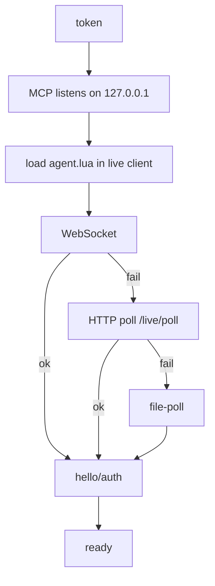
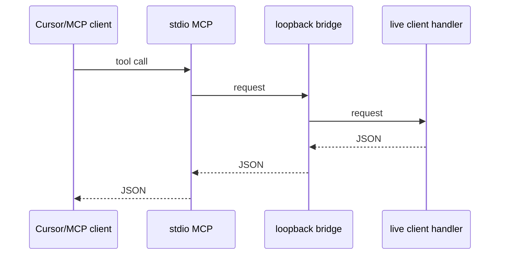

# roblox-client-mcp

stdio MCP for a live Roblox **client** (not Studio). Package
`@3xjn/roblox-client-mcp`.

You inspect a running client: instances, scripts, source, and eval. The
bridge is loopback only — bind and connect on `127.0.0.1`, not
`localhost`. Both sides share one token. The MCP owns that token: it
creates one on first start and reuses it.

## Connect

`bun install`, start the MCP, paste the Lua it prints.





### 1. Install and start

```
bun install
bun start
```

`bun start` is `bun run src/index.ts`. Cursor can spawn it over stdio.
Example `mcp.json` (Windows cwd):

```json
{
  "mcpServers": {
    "roblox-client-mcp": {
      "command": "bun",
      "args": ["run", "src/index.ts"],
      "cwd": "C:\\Users\\you\\roblox-client-mcp"
    }
  }
}
```

Don't also `bun start` by hand if Cursor is already spawning it, or the
port is taken.

On start, stderr prints the token, where it was stored, and the Lua to
paste. Stdout is MCP stdio — the token never goes there. Cursor shows
stderr in the MCP logs.

`ROBLOX_CLIENT_MCP_PORT` defaults to `32145` (live client WebSocket /
HTTP poll). `ROBLOX_CLIENT_MCP_HTTP_PORT` defaults to `32146` (Streamable
HTTP MCP at `/mcp`). Those ports must differ. Optional
`ROBLOX_CLIENT_MCP_FILEPOLL` is a host directory for the file-poll
fallback. `ROBLOX_CLIENT_MCP_TOKEN` overrides the stored token if you set
it.

Other local agents can POST `http://127.0.0.1:$HTTP_PORT/mcp` with
`Authorization: Bearer <token>` — the same token as the live bridge, same
eight tools. This is not the Lua agent's `/live/poll`.

### 2. Load the agent

Copy `agent.lua` into the executor workspace. Paste the printed Lua in
the live client. It looks like:

```lua
getgenv().RobloxClientMcp = {
    Token = "...",
}

loadstring(readfile("agent.lua"), "roblox-client-mcp")()
```

Default URL is `ws://127.0.0.1:32145/live`. The agent capability-detects
what the executor actually exposes. It requires `loadstring` and
`getgenv`. It does not switch on `identifyexecutor`.

It tries WebSocket first, then HTTP poll at `/live/poll`, then file-poll
with `writefile`/`readfile` under `roblox-client-mcp/` in the executor
workspace. If you land on file-poll, point `ROBLOX_CLIENT_MCP_FILEPOLL` at
that directory on the host.

## Runtime workflow

1. Call `roblox_status` to establish the live target, session, capabilities and limits.
2. Find candidates with `roblox_list_scripts` or `roblox_list_instances`; use the returned `ref` to inspect or recover evidence.
3. Search recovered evidence with `roblox_search_source`; expand an explicit candidate set when cache coverage is insufficient.
4. Write against observed contracts and call `roblox_validate` for syntax.
5. If execution is requested, use `roblox_eval` and verify the requested behavior with an observation or assertion.

Setup procedures are in [the setup skill](skills/live-client-setup/SKILL.md), separate from ordinary runtime work. Keep the host and copied `agent.lua` at the same revision; protocol 0.2 requires a live-agent session ID.

## Tools

Successful tools return compact JSON text and the same checked `structuredContent`, with advertised `outputSchema`. Failures use MCP `isError` and a bounded diagnostic. `roblox_status` works while disconnected; the other operations need an authenticated live agent.

| Tool | Contract |
| --- | --- |
| `roblox_status` | Bridge-local connection state, session ID, place/job, versions, transport, capabilities and limits; no client round trip. |
| `roblox_list_instances` | `children` defaults to game children. `all` without a root is global; optional `ref`/`path` restricts to that root and descendants. `nil` inspects nil getter roots and their detached descendants. Ranked rows, coverage and `nextCursor`. |
| `roblox_list_scripts` | Client-visible `all`, or exact getter scopes `running`, `loaded`, `cached`. Ranked rows, coverage and `nextCursor`. |
| `roblox_read_source` | Exactly one `ref` or unambiguous `path`; decompiled Luau with line/column continuation, constants, or unavailable evidence. `refresh` retries; bytecode requires explicit `representation: "bytecode"`. |
| `roblox_search_source` | Literal, case-sensitive source/constant search; `cached` by default. `expand` recovers at most `maxScripts` from `refs` or an inventory scope each call. Returns evidence locations, coverage and continuation. |
| `roblox_inspect` | Selected properties (1–20), optional attributes/tags/ancestry; explicit per-field failures. Never requires a module. |
| `roblox_validate` | Compile without invocation. `valid` establishes syntax only. |
| `roblox_eval` | Execute an explicit chunk; preserves nil positions and total return count, with bounded values and traceback diagnostics. Completion does not verify later callbacks. |

References identify exact observed instances, including duplicate sibling names and detached objects. They are shared across MCP clients using the same live agent, weakly held, bounded, and invalidated when that agent is replaced. They are diagnostic handles, not permanent locators for generated scripts. Paths are descriptive; ambiguous path input fails.

Capability presence permits an attempt, not a guarantee. Read `coverage`: unavailable getters, failed getters, successful empty inventories and partially processed inventories are distinct. A zero-match cache-only or partial search is not proof of absence. Only decompiled matches have source line numbers; a constant match is not proof of behavior.

See [runtime contracts and limits](docs/runtime-contracts.md) and [the reproducible benchmark](docs/benchmark.md).

## Development

```
bun install
bun run check
bun run benchmark
```

`check` includes TypeScript, Biome, compilation of the actual `agent.lua` using pinned Luau WASM, and transport/MCP/actual-Lua fixture tests. The fixture is a small client surface, not a full Roblox simulator. Live executor verification and model-run benchmark steps are documented separately.
